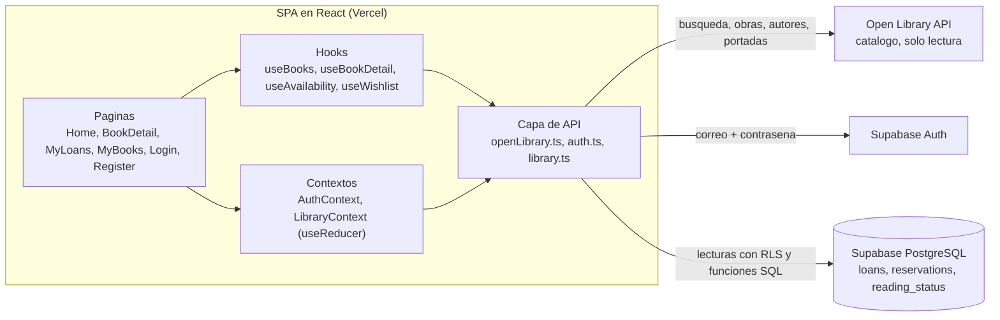
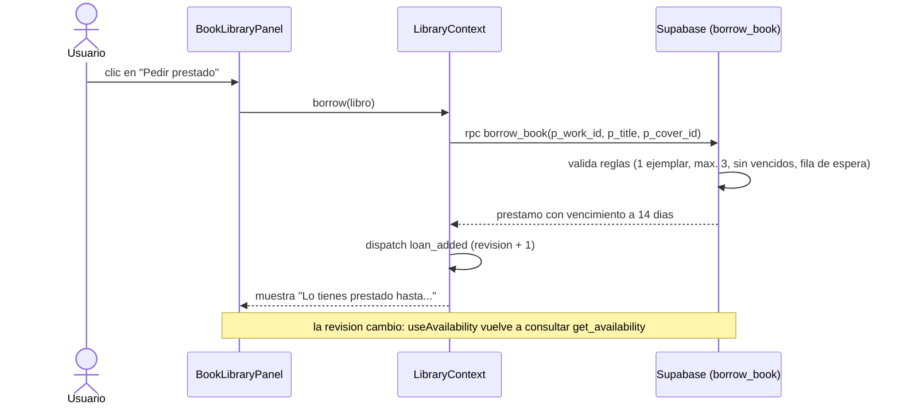
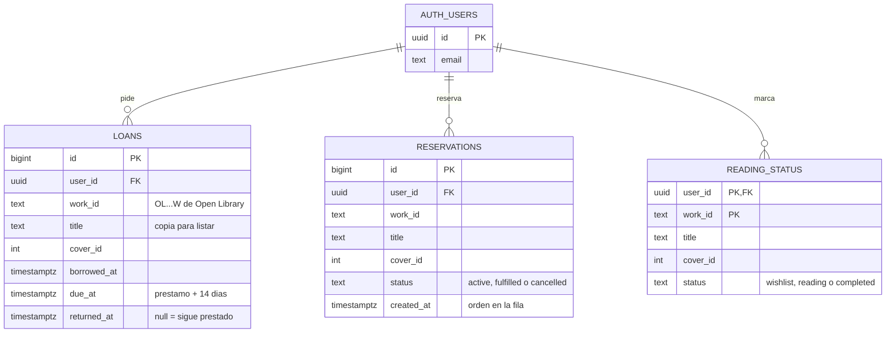
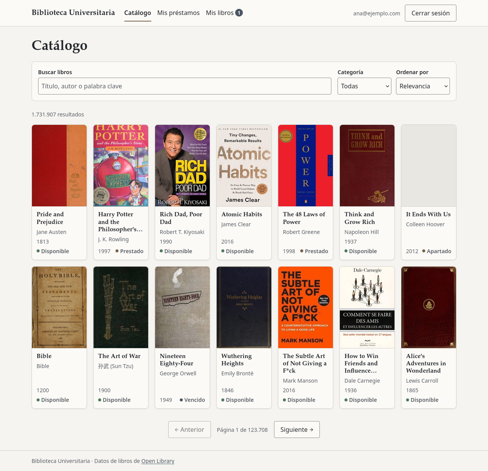
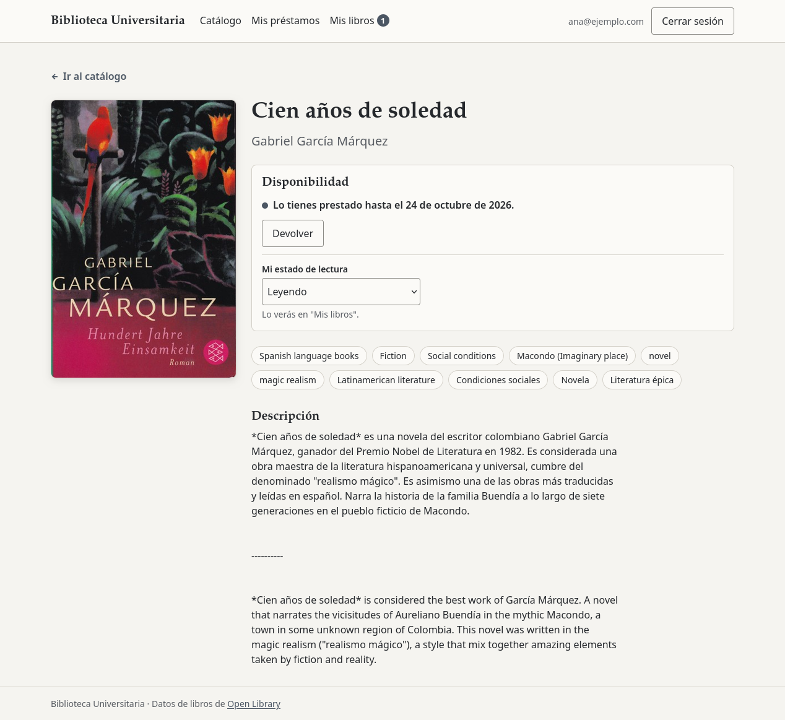
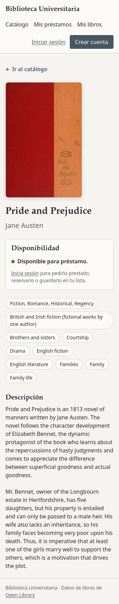
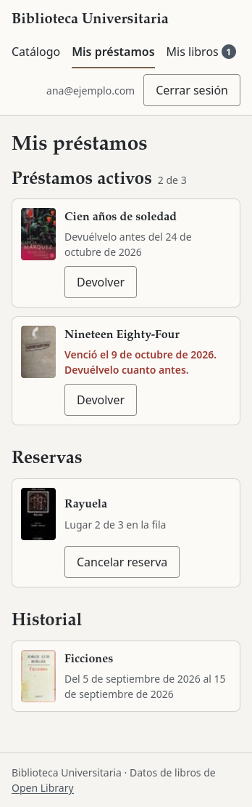
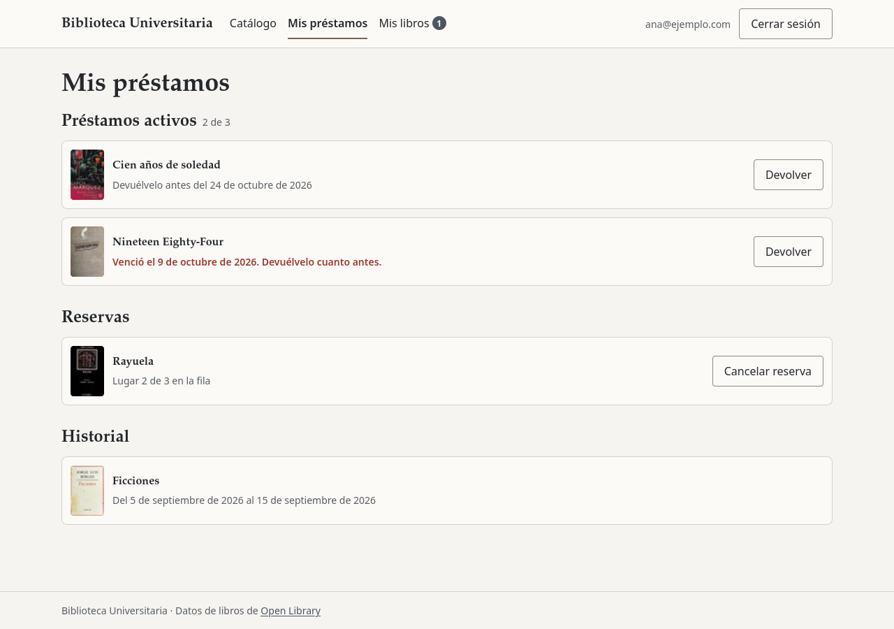
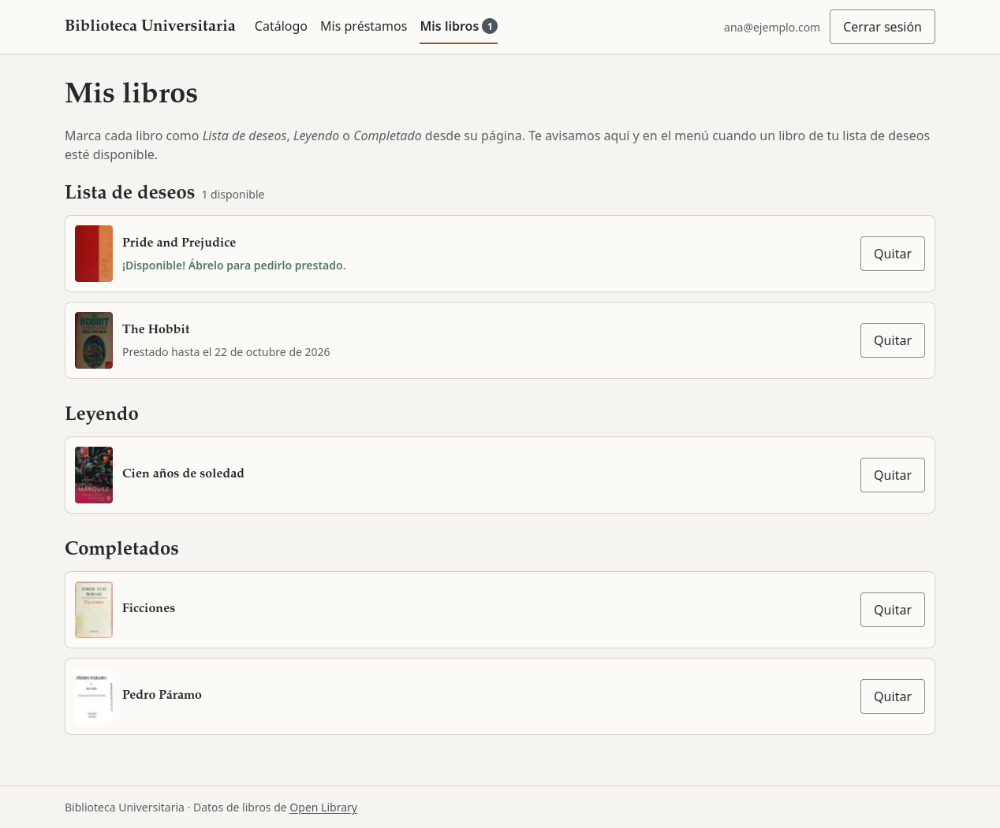

# Arquitectura, modelo de datos y maquetas

Entregables de la semana 2 del enunciado: diagrama de arquitectura del frontend, modelo de datos de usuarios e historial de prestamos, y maquetas de las paginas clave.

---

## 1. Arquitectura

| Capa | Archivos | Responsabilidad |
|---|---|---|
| Paginas | `src/pages/` | Una por ruta. Todas salvo el catalogo se cargan con `React.lazy` |
| Componentes | `src/components/` | Piezas de interfaz reutilizables (tarjeta, panel de prestamo, formulario...) |
| Hooks | `src/hooks/` | Logica con estado: busqueda paginada, detalle, disponibilidad, lista de deseos |
| Contextos | `src/context/` | Estado global: sesion (`AuthContext`) y biblioteca del usuario (`LibraryContext` con `useReducer`) |
| API | `src/api/` | Unico lugar que habla con Open Library y Supabase; convierte las respuestas al formato de la app |
| Utilidades | `src/utils/` | Funciones puras: validacion, fechas, disponibilidad, URL |

### Donde vive cada estado

| Estado | Donde | Por que |
|---|---|---|
| Busqueda, categoria, orden y pagina | URL (`useSearchParams`) | Sobrevive a "Atras", a recargar y a compartir el enlace |
| Resultados de la busqueda | `useBooks` (`useReducer`) | Solo los usa el catalogo |
| Sesion | `AuthContext` | La necesitan el header, las rutas protegidas y la biblioteca |
| Prestamos, reservas y lista | `LibraryContext` (`useReducer`) | Se cargan una vez al iniciar sesion y los usan el detalle, "Mis prestamos", "Mis libros" y el aviso del menu |
| Disponibilidad | `useAvailability` | Se consulta por pagina (una sola llamada) y se renueva tras cada prestamo, devolucion o reserva |
| Formularios | `useState` en cada pagina | Estado local |

### Flujo de un prestamo

---

## 2. Modelo de datos

El catalogo es de Open Library (solo lectura). Supabase guarda lo que hace cada usuario. Ambos se unen por `work_id`, el id de la obra en Open Library (ej. `OL82563W`), el mismo que usa la ruta `/libro/:id`. Esquema completo: [`capstone/supabase/schema.sql`](../capstone/supabase/schema.sql).

- `auth.users` es la tabla de usuarios de Supabase Auth; no hace falta una tabla de perfiles.
- `title` y `cover_id` son una copia: "Mis prestamos" y "Mis libros" se listan sin pedirle cada libro a Open Library.
- Estados que **se calculan**, no se guardan: activo (`returned_at` vacio), vencido (activo y `due_at` pasado), historial (`returned_at` con fecha).

### Reglas en la base de datos

| Regla | Como se garantiza |
|---|---|
| 1 ejemplar por libro | Indice unico parcial sobre `loans (work_id)` donde `returned_at is null` (funciona aunque dos personas pidan el libro a la vez) |
| Una reserva activa por usuario y libro | Indice unico parcial sobre `reservations (user_id, work_id)` donde `status = 'active'` |
| Un estado de lectura por usuario y libro | Clave primaria compuesta `(user_id, work_id)` |
| Datos validos | `check`: formato `OL[0-9]+W`, titulo de 1 a 500 caracteres, estados permitidos, fechas coherentes |
| 14 dias, maximo 3 activos, sin vencidos, prioridad de la fila | Funcion `borrow_book` |

### Funciones

| Funcion | Quien puede llamarla | Que hace |
|---|---|---|
| `get_availability(work_ids)` | Cualquiera | Libros prestados o con fila: vencimiento, personas en la fila y tu lugar. No revela quien los tiene |
| `borrow_book(p_work_id, p_title, p_cover_id)` | Usuarios con sesion | Valida las reglas y crea el prestamo; si el usuario estaba en la fila, cumple su reserva |
| `return_book(p_loan_id)` | Usuarios con sesion | Devuelve un prestamo propio y activo |
| `reserve_book(p_work_id, p_title, p_cover_id)` | Usuarios con sesion | Entra a la fila de un libro no disponible |
| `cancel_reservation(p_reservation_id)` | Usuarios con sesion | Cancela una reserva propia |

### Seguridad

| Tabla | Leer | Escribir |
|---|---|---|
| `loans` | Solo las propias (RLS) | Solo con `borrow_book` / `return_book` |
| `reservations` | Solo las propias (RLS) | Solo con `reserve_book` / `cancel_reservation` |
| `reading_status` | Solo las propias (RLS) | Directo, solo las propias (RLS) |

Las funciones usan `security definer` (corren con permisos del administrador, pero solo hacen lo que su codigo permite) y `search_path = ''`. Los errores de reglas llevan el codigo `P0001` y la app muestra su mensaje; cualquier otro error se reemplaza por un mensaje generico.

---

## 3. Maquetas

Capturas de la aplicacion implementada. Las paginas con sesion usan datos de demostracion.

### Catalogo (busqueda, filtros y disponibilidad)

### Detalle del libro

| Movil, sin sesion | "Mis prestamos" en movil |
|---|---|
|  |  |

### Mis prestamos

### Mis libros (lista de deseos con aviso)

