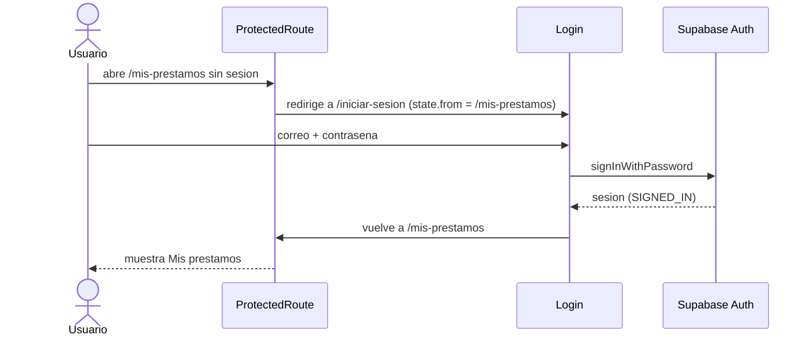
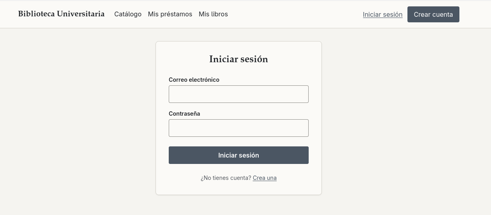
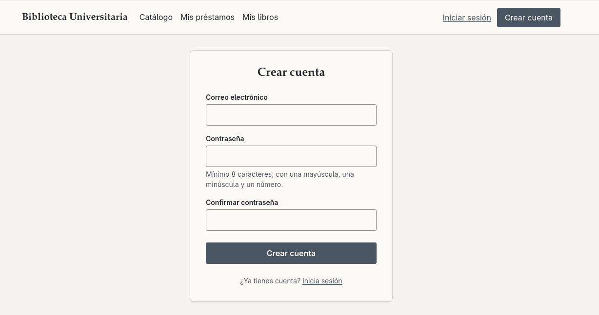

# Flujo de autenticacion

La autenticacion usa **Supabase Auth** con **correo + contrasena**. La confirmacion por correo esta desactivada para que cualquiera pueda probar la app: al registrarse, la sesion queda iniciada de inmediato.

---

## Piezas

| Archivo | Rol |
|---|---|
| `src/api/supabase.ts` | Crea el cliente de Supabase con `VITE_SUPABASE_URL` y la clave _publishable_ |
| `src/api/auth.ts` | `signUp`, `signIn`, `signOut` y `getAuthErrorMessage` (traduce los errores de Supabase por su codigo) |
| `src/context/AuthProvider.tsx` | Escucha a Supabase y guarda `user` e `isLoading` en un Context |
| `src/hooks/useAuth.ts` | Lee ese Context desde cualquier componente |
| `src/components/ProtectedRoute.tsx` | Deja pasar solo con sesion; si no, redirige al login recordando la pagina pedida |
| `src/pages/Register.tsx` / `Login.tsx` | Formularios con validacion (`src/utils/validation.ts`) |
| `src/components/Layout.tsx` | Muestra el correo y "Cerrar sesion", o "Iniciar sesion" / "Crear cuenta" |

---

## Flujos

**Al abrir o recargar la app**

1. `AuthProvider` se suscribe con `supabase.auth.onAuthStateChange`.
2. Supabase lee la sesion guardada en `localStorage` y emite `INITIAL_SESSION` (con usuario o `null`).
3. `isLoading` pasa a `false`. Mientras es `true`, el header oculta los botones de sesion y `ProtectedRoute` muestra "Comprobando sesion...", asi nunca redirige antes de saber si hay usuario.

**Registro** (`/registro`)

1. Valida en el navegador: correo con formato valido; contrasena de 8+ caracteres con minuscula, mayuscula y numero; las dos contrasenas iguales.
2. `signUp` -> Supabase crea la cuenta (vuelve a validar la contrasena en el servidor) y abre la sesion.
3. `onAuthStateChange` emite `SIGNED_IN` -> `user` cambia -> la pagina redirige al catalogo.

**Inicio de sesion** (`/iniciar-sesion`)

1. Valida el formato del correo y que haya contrasena (las reglas de 8+ caracteres son para crearla, no para usarla); si algo falla, el foco va al primer campo con error.
2. `signIn` -> si falla, se muestra el error traducido (ej. "Correo o contrasena incorrectos.").
3. Si funciona, `SIGNED_IN` -> vuelve a la pagina de origen (`state.from`) o al catalogo.

**Ruta protegida** (`/mis-prestamos`)

**Cerrar sesion**

`signOut` -> Supabase borra la sesion -> `SIGNED_OUT` -> `user = null` -> el header vuelve a mostrar "Iniciar sesion" y las rutas protegidas redirigen al login.

**Sesion persistente:** Supabase guarda la sesion en `localStorage` y renueva el token antes de que venza (`TOKEN_REFRESHED`), por eso la sesion sigue activa al recargar o volver otro dia.

---

## Seguridad

- **La validacion del navegador es para la experiencia de uso;** la que manda es la de Supabase (politica de contrasena configurada en el panel).
- **`ProtectedRoute` tampoco es seguridad:** solo decide que pagina mostrar. Los datos los protegen las politicas **RLS** de la base de datos (cada usuario solo ve sus filas).
- **Sin redirecciones a otras webs:** `getRedirectPath` (`src/utils/url.ts`) solo acepta rutas internas (`/...`), nunca `//otro-sitio.com` ni `https://...`.
- **Clave publishable:** es publica por diseno y va en el frontend. La clave `sb_secret_...` nunca va en el codigo.
- **Errores:** se traducen por codigo (`invalid_credentials`, `weak_password`...), no por el texto en ingles, y nunca se muestra el error tecnico al usuario.

Pruebas de este flujo: `src/pages/Login.test.tsx` y `src/api/auth.test.ts` (ver [Testing.md](Testing.md)).

## Capturas

### Inicio de sesion (`/iniciar-sesion`)

### Registro (`/registro`)

La pista de la contrasena ("Minimo 8 caracteres, con una mayuscula, una minuscula y un numero") esta conectada al campo con `aria-describedby`, asi el lector de pantalla la lee al entrar en el campo.

