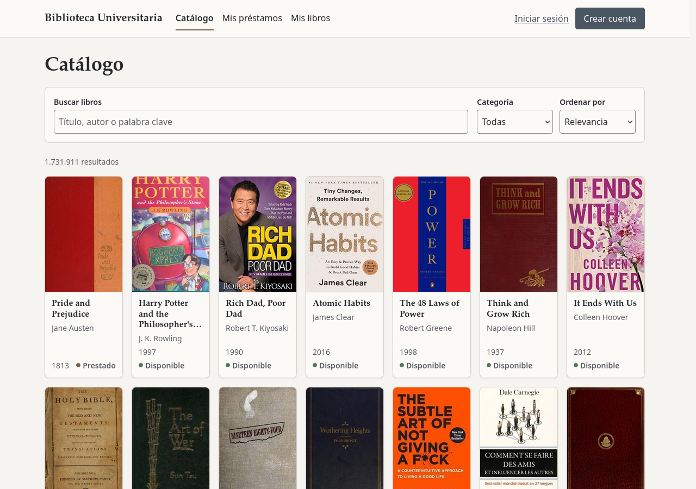

# Despliegue: GitHub + Vercel + Supabase

**URL de produccion:** `https://react-project-nu-three-53.vercel.app/`

---

## URL Publica en vivo de la aplicacion



## Instrucciones

---

## 1. Rewrites para la SPA (`capstone/vercel.json`)

```json
{
  "buildCommand": "npm run test:run && npm run build",
  "rewrites": [{ "source": "/(.*)", "destination": "/index.html" }]
}
```

`buildCommand` corre las pruebas antes de construir: si alguna falla, Vercel no publica la nueva version.

En Vercel cada URL busca un archivo. Rutas de React Router como `/libro/OL82563W` no existen como archivo, asi que al recargar la pagina darian 404. La regla dice: _si no hay un archivo con ese nombre, entrega `index.html`_; React Router lee la URL y muestra la pagina correcta. Los archivos reales (`/assets/index-xxx.js`, `/favicon.svg`) se siguen sirviendo normal, porque Vercel revisa primero si el archivo existe.

---

## 2. Crear el repositorio en GitHub

1. **github.com -> New repository**.
2. Nombre: `React-Project`.
3. Visibilidad: **Private**.
4. **No** marcar _README_, _.gitignore_ ni _license_: el repositorio debe quedar vacio para que el primer push no choque con un commit creado por GitHub.

Si el repositorio ya existe como publico: **Settings -> General -> Danger Zone -> Change repository visibility -> Make private**.

**Comprobar:** abrir `https://github.com/EgCooper/React-Project` en una ventana de incognito (sin sesion). Debe responder **404**.

---

## 3. Verificar la llave SSH en GitHub

```bash
ssh -T git@github.com
```

- `Hi <usuario>! You've successfully authenticated` -> listo.
- `Permission denied (publickey)` -> copiar la llave publica (`cat ~/.ssh/id_ed25519.pub` o `id_rsa.pub`) y pegarla en **GitHub -> Settings -> SSH and GPG keys -> New SSH key**. Puede ser la misma llave que se usa con GitLab.

---

## 4. Configurar `git push` para subir a ambos repositorios

Desde la raiz del repositorio (`Capstone/`):

```bash
git remote set-url --add --push origin git@gitlab.com:jala-university1/cohort-3/ES.CO.CSWB-366.GA.T2.26.M2/SC/victor-pinto/capstone/library.git
git remote set-url --add --push origin git@github.com:EgCooper/React-Project.git
git remote -v
git push
```

| Comando | Que hace |
|---|---|
| Primer `set-url --add --push` (GitLab) | Registra GitLab como destino de push. Es necesario aunque ya fuera el remoto original: al agregar la primera URL de push, Git deja de usar la URL original para subir |
| Segundo `set-url --add --push` (GitHub) | Agrega GitHub como segundo destino |
| `git remote -v` | Muestra la configuracion final |
| `git push` | Sube a los dos repositorios, uno despues del otro |

`git remote -v` debe quedar **exactamente** asi (1 fetch y 2 push):

```
origin  git@gitlab.com:.../library.git              (fetch)
origin  git@gitlab.com:.../library.git              (push)
origin  git@github.com:EgCooper/React-Project.git   (push)
```

- `git pull` / `git fetch` siguen bajando solo de GitLab.
- `git push` muestra dos bloques de salida, uno por repositorio.

### Corregir URLs de push de mas

Si se agrega una URL equivocada o repetida, `--delete` borra todas las URLs de push que contienen el texto indicado. Despues se vuelve a agregar la correcta una sola vez:

```bash
git remote set-url --delete --push origin 'EgCooper/library'         # una URL equivocada
git remote set-url --delete --push origin 'EgCooper/React-Project'   # borra tambien las repetidas
git remote set-url --add --push origin git@github.com:EgCooper/React-Project.git
git remote -v
```

**Comprobar que ambos repositorios tienen el mismo commit:**

```bash
git ls-remote --heads git@github.com:EgCooper/React-Project.git
git ls-remote --heads origin
git rev-parse HEAD
```

Los tres deben mostrar el mismo hash en `main`.

---

## 5. Crear el proyecto en Vercel

1. **vercel.com -> Sign Up** con la cuenta de **GitHub**.
2. **Add New... -> Project** -> elegir `React-Project` -> **Import**.
3. Configuracion:

| Campo | Valor | Por que |
|---|---|---|
| **Root Directory** | `capstone` | El repositorio tiene `Docs/` y `capstone/`; la app esta en `capstone/` |
| **Framework Preset** | Vite (se detecta solo) | Salida: `dist`. El comando de build lo define `vercel.json`: `npm run test:run && npm run build` (si una prueba falla, no se despliega) |
| **Environment Variables** | Las 4 de `.env.example` con sus valores | Ver la seccion de variables de entorno |

4. **Deploy**.

A partir de aqui, cada push a `main` en GitHub genera un despliegue de produccion, y cada push a otra rama genera una URL de prueba (_Preview_).

---

## 6. Configurar Supabase

**Supabase -> Authentication -> URL Configuration**:

| Campo | Valor | Por que |
|---|---|---|
| **Site URL** | La URL de produccion de Vercel | Los correos y redirecciones de Supabase (ej. recuperar contrasena) apuntan a produccion y no a `localhost` |
| **Redirect URLs** _(recomendado)_ | `http://localhost:5173/**` | Permite que esos mismos flujos sigan funcionando en desarrollo |

Con email + contrasena y la confirmacion de correo desactivada, el login funciona sin estas URLs; se configuran para que cualquier correo futuro de Supabase lleve al sitio correcto.

---

## Variables de entorno: desarrollo y produccion


| Entorno | Donde viven las variables | En el repo |
|---|---|---|
| Desarrollo (`npm run dev`) | `capstone/.env` | No (`.gitignore`) |
| Produccion (Vercel) | Vercel -> Project -> Settings -> Environment Variables (_Production_) | No |
| Documentacion | `capstone/.env.example` (nombres, sin valores) | Si |

Variables: `VITE_OPEN_LIBRARY_URL`, `VITE_COVERS_URL`, `VITE_SUPABASE_URL`, `VITE_SUPABASE_PUBLISHABLE_KEY`.


