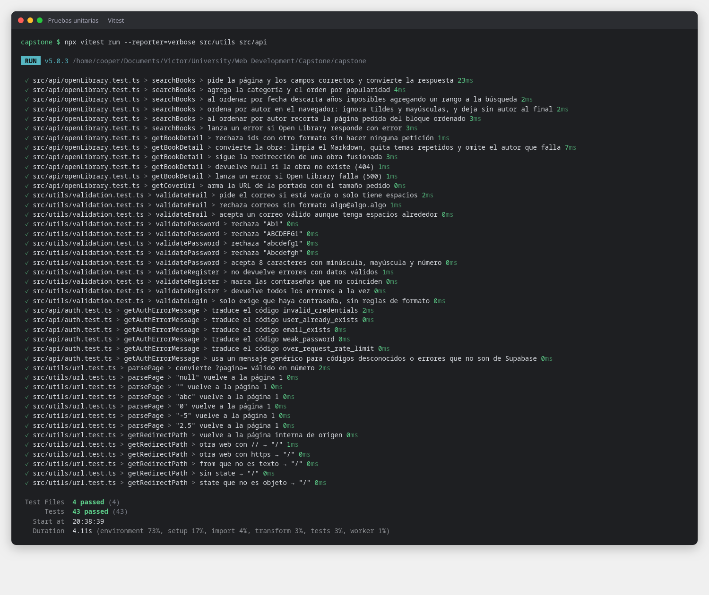

# Pruebas unitarias y de integracion

**Resultado:** 55 pruebas en verde: 43 unitarias y 12 de integracion (semana 6 del enunciado).

---

## Herramientas

| Paquete | Version | Para que |
|---|---|---|
| **Vitest** | 5 | Ejecuta las pruebas; usa la misma configuracion que Vite |
| **jsdom** | 30 | Navegador simulado en Node (`document`, `window`, `localStorage`) |
| **@testing-library/react** + **@testing-library/dom** | 16 / 10 | Renderiza componentes y busca elementos como una persona: por rol, texto o etiqueta |
| **@testing-library/user-event** | 14 | Simula escribir, hacer clic y elegir opciones |
| **@testing-library/jest-dom** | 7 | Comprobaciones del DOM: `toBeInTheDocument`, `toHaveFocus`, `toHaveAttribute`... |
| **MSW** (Mock Service Worker) | 2 | Responde las peticiones `fetch` con datos falsos: las pruebas no dependen de Open Library ni de Supabase |

## Instalacion

```bash
cd capstone
npm install -D vitest jsdom @testing-library/react @testing-library/dom @testing-library/jest-dom @testing-library/user-event msw@2
```

| Archivo | Configuracion |
|---|---|
| `capstone/vite.config.ts` | Bloque `test`: entorno `jsdom`, archivo de setup y URLs falsas (`https://openlibrary.test`, `https://supabase.test`) |
| `capstone/src/test/setup.ts` | Activa jest-dom, enciende MSW (`onUnhandledRequest: 'error'`: una peticion no simulada hace fallar la prueba) y limpia despues de cada prueba |
| `capstone/src/test/server.ts` | Servidor de MSW; cada prueba define sus respuestas con `server.use(...)` |
| `capstone/package.json` | Scripts `test` (modo vigilancia) y `test:run` (una sola vez) |
| `capstone/vercel.json` | `"buildCommand": "npm run test:run && npm run build"`: si una prueba falla, Vercel no despliega |

```bash
npm test           # vigila los archivos y repite las pruebas al guardar (salir con q)
npm run test:run   # una sola vez (lo que corre Vercel)
```

---

## Archivos implementados

| Archivo | Tipo | Que prueba | Pruebas |
|---|---|---|---|
| [`src/utils/validation.test.ts`](../capstone/src/utils/validation.test.ts) | Unitaria | Correo, contrasena (8 caracteres, minuscula, mayuscula, numero), registro y login | 12 |
| [`src/utils/url.test.ts`](../capstone/src/utils/url.test.ts) | Unitaria | `parsePage` (`?pagina=` invalido vuelve a 1) y `getRedirectPath` (evita redirigir a otra web tras el login) | 13 |
| [`src/api/auth.test.ts`](../capstone/src/api/auth.test.ts) | Unitaria | Traduccion de los errores de Supabase al espanol | 6 |
| [`src/api/openLibrary.test.ts`](../capstone/src/api/openLibrary.test.ts) | Unitaria (red simulada) | Parametros de busqueda, categoria, orden por fecha y por autor, errores; detalle: Markdown, temas repetidos, redirecciones, 404 | 12 |
| [`src/pages/Home.test.tsx`](../capstone/src/pages/Home.test.tsx) | Integracion | Catalogo inicial, busqueda con resultados atenuados mientras carga, categoria, paginacion, estado vacio + "Limpiar", error + "Reintentar" | 6 |
| [`src/pages/BookDetail.test.tsx`](../capstone/src/pages/BookDetail.test.tsx) | Integracion | Abrir un libro desde el catalogo, foco al cambiar de pagina, "Volver", URL directa y libro inexistente, error + "Reintentar" | 3 |
| [`src/pages/Login.test.tsx`](../capstone/src/pages/Login.test.tsx) | Integracion | Validacion y foco en el primer campo invalido, credenciales incorrectas, ruta protegida -> login -> vuelve a "Mis prestamos" -> cerrar sesion | 3 |

Archivos de apoyo:

- [`src/test/renderApp.tsx`](../capstone/src/test/renderApp.tsx): renderiza la app completa (rutas, Layout, AuthProvider) en una ruta dada, con un router en memoria.
- [`src/test/openLibraryMocks.ts`](../capstone/src/test/openLibraryMocks.ts): arma respuestas falsas con la misma forma que las de Open Library.
- `parsePage` y `getRedirectPath` se movieron de `Home.tsx` y `Login.tsx` a [`src/utils/url.ts`](../capstone/src/utils/url.ts) para poder probarlas solas.

**Unitaria vs integracion:** una prueba unitaria revisa una funcion sola (entrada -> salida esperada). Una de integracion monta la app completa y la usa como una persona: escribe en el buscador, hace clic en "Reintentar" y comprueba lo que aparece en pantalla.

Ejemplo de prueba de integracion (`Home.test.tsx`):

```tsx
it('si Open Library falla muestra la alerta y "Reintentar" vuelve a cargar', async () => {
  let calls = 0
  mockSearch(() => {
    calls += 1
    return calls === 1 ? new HttpResponse(null, { status: 500 }) : searchResponse(DEFAULT_BOOKS)
  })
  const { user } = renderApp('/')

  expect(await screen.findByRole('alert')).toHaveTextContent('No se pudieron cargar los libros. Intenta de nuevo.')

  await user.click(screen.getByRole('button', { name: 'Reintentar' }))

  expect(await screen.findByRole('link', { name: 'Cien años de soledad' })).toBeInTheDocument()
  expect(screen.queryByRole('alert')).not.toBeInTheDocument()
})
```

---

## Evidencias

### Pruebas unitarias (43)



### Pruebas de integracion (12)


