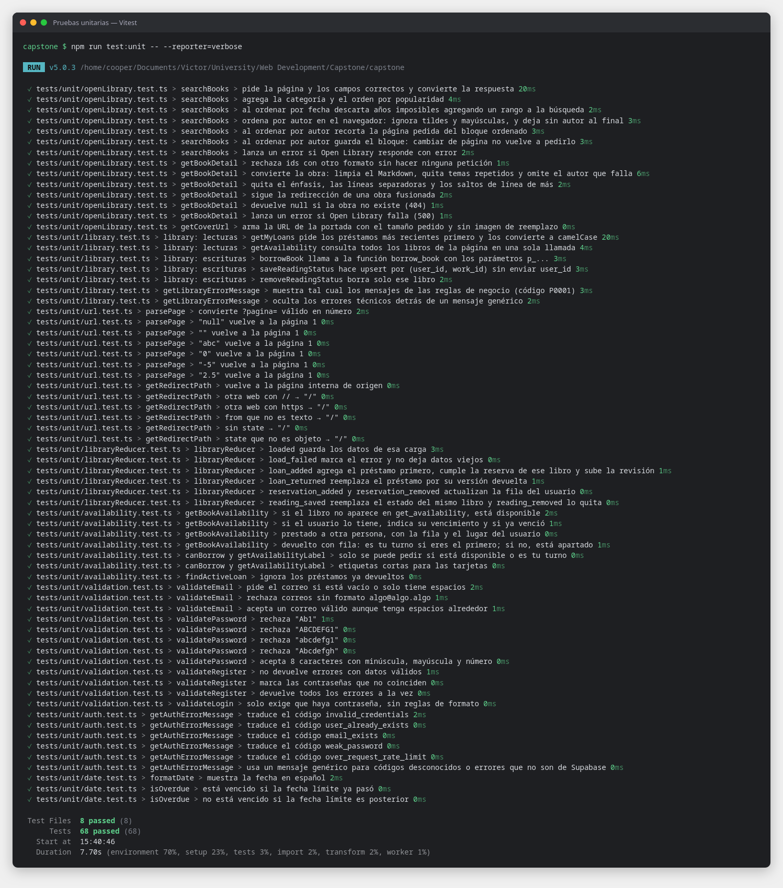
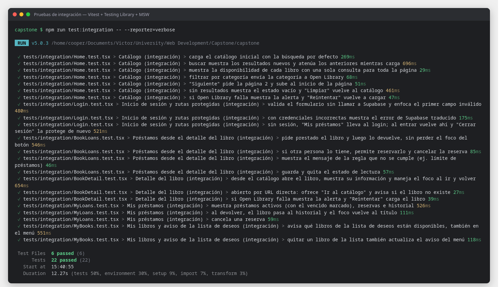
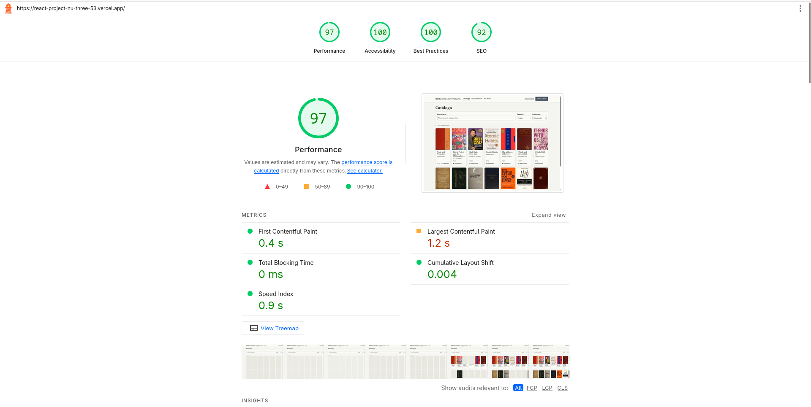
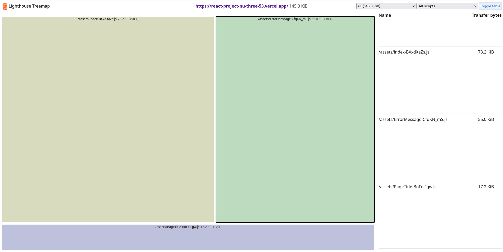

# Pruebas unitarias y de integracion

**Resultado:** 90 pruebas en verde: 68 unitarias y 22 de integracion (semana 6 del enunciado).

---

## Herramientas

| Paquete | Version | Para que |
|---|---|---|
| **Vitest** | 5 | Ejecuta las pruebas; usa la misma configuracion que Vite |
| **jsdom** | 30 | Navegador simulado en Node (`document`, `window`, `localStorage`) |
| **@testing-library/react** + **@testing-library/dom** | 16 / 10 | Renderiza componentes y busca elementos como una persona: por rol, texto o etiqueta |
| **@testing-library/user-event** | 14 | Simula escribir, hacer clic y elegir opciones |
| **@testing-library/jest-dom** | 7 | Comprobaciones del DOM: `toBeInTheDocument`, `toHaveFocus`, `toHaveAttribute`... |
| **MSW** (Mock Service Worker) | 2 | Responde las peticiones `fetch` con datos falsos: las pruebas no dependen de Open Library ni de Supabase |

## Instalacion

```bash
cd capstone
npm install -D vitest jsdom @testing-library/react @testing-library/dom @testing-library/jest-dom @testing-library/user-event msw@2
```

| Archivo | Configuracion |
|---|---|
| `capstone/vite.config.ts` | Bloque `test`: entorno `jsdom`, archivo de setup y URLs falsas (`https://openlibrary.test`, `https://supabase.test`) |
| `capstone/tsconfig.app.json` | `"include": ["src", "tests"]`: TypeScript tambien revisa los tipos de las pruebas |
| `capstone/tests/support/setup.ts` | Activa jest-dom, enciende MSW (`onUnhandledRequest: 'error'`: una peticion no simulada hace fallar la prueba) y limpia despues de cada prueba |
| `capstone/tests/support/server.ts` | Servidor de MSW; cada prueba define sus respuestas con `server.use(...)` |
| `capstone/tests/support/handlers.ts` | Respuestas por defecto de Supabase: sin prestamos, sin reservas y todos los libros disponibles |
| `capstone/package.json` | Scripts `test` (modo vigilancia), `test:run` (todas, una vez), `test:unit` y `test:integration` |
| `capstone/vercel.json` | `"buildCommand": "npm run test:run && npm run build"`: si una prueba falla, Vercel no despliega |

```bash
npm test                  # vigila los archivos y repite las pruebas al guardar (salir con q)
npm run test:run          # todas, una sola vez (lo que corre Vercel)
npm run test:unit         # solo las unitarias
npm run test:integration  # solo las de integracion
```

## Organizacion

Las pruebas viven fuera de `src/`, separadas por tipo; `src/` queda solo con el codigo de la app.

```
capstone/
├── src/                 codigo de la aplicacion
└── tests/
    ├── unit/            8 archivos: funciones solas (68 pruebas)
    ├── integration/     6 archivos: la app completa, como la usaria una persona (22 pruebas)
    └── support/         configuracion, servidor de MSW y datos simulados
```

---

## Archivos implementados

| Archivo | Tipo | Que prueba | Pruebas |
|---|---|---|---|
| [`tests/unit/validation.test.ts`](../capstone/tests/unit/validation.test.ts) | Unitaria | Correo, contrasena (8 caracteres, minuscula, mayuscula, numero), registro y login | 12 |
| [`tests/unit/url.test.ts`](../capstone/tests/unit/url.test.ts) | Unitaria | `parsePage` (`?pagina=` invalido vuelve a 1) y `getRedirectPath` (evita redirigir a otra web tras el login) | 13 |
| [`tests/unit/auth.test.ts`](../capstone/tests/unit/auth.test.ts) | Unitaria | Traduccion de los errores de Supabase al espanol | 6 |
| [`tests/unit/openLibrary.test.ts`](../capstone/tests/unit/openLibrary.test.ts) | Unitaria (red simulada) | Parametros de busqueda, categoria, orden por fecha y por autor (y su cache), errores; detalle: limpieza de Markdown (enlaces, enfasis, separadores), temas repetidos, redirecciones, 404 | 14 |
| [`tests/unit/library.test.ts`](../capstone/tests/unit/library.test.ts) | Unitaria (red simulada) | Llamadas a Supabase: parametros de las funciones SQL, upsert del estado de lectura, conversion a camelCase y que solo los errores `P0001` lleguen al usuario | 7 |
| [`tests/unit/libraryReducer.test.ts`](../capstone/tests/unit/libraryReducer.test.ts) | Unitaria | Reducer de `LibraryContext`: cargar, prestar (cumple la reserva), devolver, reservar, cancelar y estado de lectura | 6 |
| [`tests/unit/availability.test.ts`](../capstone/tests/unit/availability.test.ts) | Unitaria | Situacion de un libro: disponible, tuyo (y vencido), prestado, tu turno, apartado; etiquetas | 7 |
| [`tests/unit/date.test.ts`](../capstone/tests/unit/date.test.ts) | Unitaria | Formato de fechas en espanol y vencimiento | 3 |
| [`tests/integration/Home.test.tsx`](../capstone/tests/integration/Home.test.tsx) | Integracion | Catalogo inicial, busqueda con resultados atenuados mientras carga, disponibilidad en una consulta, categoria, paginacion, estado vacio + "Limpiar", error + "Reintentar" | 7 |
| [`tests/integration/BookDetail.test.tsx`](../capstone/tests/integration/BookDetail.test.tsx) | Integracion | Abrir un libro desde el catalogo, foco al cambiar de pagina, "Volver", URL directa y libro inexistente, error + "Reintentar" | 3 |
| [`tests/integration/Login.test.tsx`](../capstone/tests/integration/Login.test.tsx) | Integracion | Validacion y foco en el primer campo invalido, credenciales incorrectas, ruta protegida -> login -> vuelve a "Mis prestamos" -> cerrar sesion | 3 |
| [`tests/integration/BookLoans.test.tsx`](../capstone/tests/integration/BookLoans.test.tsx) | Integracion | Desde el detalle: pedir prestado y devolver (sin perder el foco), reservar y cancelar, mensaje de una regla que no se cumple, estado de lectura | 4 |
| [`tests/integration/MyLoans.test.tsx`](../capstone/tests/integration/MyLoans.test.tsx) | Integracion | Prestamos activos (vencido marcado), reservas con su lugar en la fila, historial; devolver y cancelar | 3 |
| [`tests/integration/MyBooks.test.tsx`](../capstone/tests/integration/MyBooks.test.tsx) | Integracion | Aviso "¡Disponible!" de la lista de deseos (tambien en el menu), leyendo y completados; quitar un libro | 2 |

Archivos de apoyo:

- [`tests/support/renderApp.tsx`](../capstone/tests/support/renderApp.tsx): renderiza la app completa (rutas, Layout, AuthProvider, LibraryProvider) en una ruta dada, con un router en memoria.
- [`tests/support/openLibraryMocks.ts`](../capstone/tests/support/openLibraryMocks.ts) y [`tests/support/libraryMocks.ts`](../capstone/tests/support/libraryMocks.ts): arman respuestas falsas con la misma forma que las de Open Library y Supabase.
- [`tests/support/auth.ts`](../capstone/tests/support/auth.ts): `signInTestUser()` inicia sesion antes de renderizar, sin pasar por el formulario.
- `parsePage` y `getRedirectPath` se movieron de `Home.tsx` y `Login.tsx` a [`src/utils/url.ts`](../capstone/src/utils/url.ts) para poder probarlas solas.

**Unitaria vs integracion:** una prueba unitaria revisa una funcion sola (entrada -> salida esperada). Una de integracion monta la app completa y la usa como una persona: escribe en el buscador, hace clic en "Reintentar" y comprueba lo que aparece en pantalla.

Ejemplo de prueba de integracion (`tests/integration/Home.test.tsx`):

```tsx
it('si Open Library falla muestra la alerta y "Reintentar" vuelve a cargar', async () => {
  let calls = 0
  mockSearch(() => {
    calls += 1
    return calls === 1 ? new HttpResponse(null, { status: 500 }) : searchResponse(DEFAULT_BOOKS)
  })
  const { user } = renderApp('/')

  expect(await screen.findByRole('alert')).toHaveTextContent('No se pudieron cargar los libros. Intenta de nuevo.')

  await user.click(screen.getByRole('button', { name: 'Reintentar' }))

  expect(await screen.findByRole('link', { name: 'Cien años de soledad' })).toBeInTheDocument()
  expect(screen.queryByRole('alert')).not.toBeInTheDocument()
})
```

---

## Evidencias

### Pruebas unitarias (68)



### Pruebas de integracion (22)



### Accesibilidad

Ademas de las pruebas, se reviso cada pagina con **axe-core** (el motor de accesibilidad de Lighthouse) en Firefox: catalogo, detalle (con y sin sesion), "Mis prestamos" y "Mis libros" dieron **0 problemas**.

### Lighthouse (produccion)

Informe de Lighthouse en Chrome sobre https://react-project-nu-three-53.vercel.app/ (catalogo, modo escritorio):

| Categoria | Puntaje |
|---|---|
| Performance | **97** |
| Accessibility | **100** |
| Best Practices | **100** |
| SEO | **92** |

| Metrica | Valor | Que mide |
|---|---|---|
| First Contentful Paint | 0.4 s | Cuando aparece el primer contenido |
| Largest Contentful Paint | 1.2 s | Cuando aparece el elemento mas grande (las portadas) |
| Total Blocking Time | 0 ms | Tiempo en que la pagina no responde a clics |
| Cumulative Layout Shift | 0.004 | Cuanto "salta" la pagina al cargar (las tarjetas de relleno lo evitan) |
| Speed Index | 0.9 s | Que tan rapido se completa lo visible |



**JavaScript descargado: 145.3 KiB** (comprimido) en 3 archivos. Las demas paginas (detalle, "Mis prestamos", "Mis libros", login...) no estan aqui: se descargan solo cuando se visitan, gracias a `React.lazy`.


